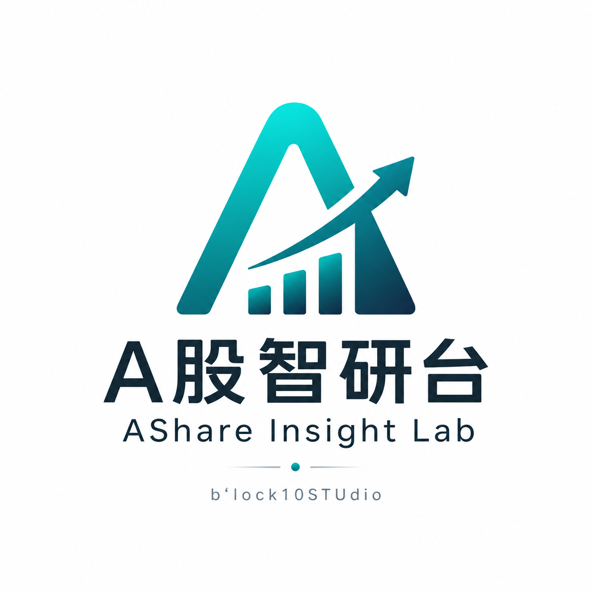
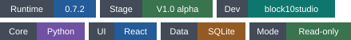

<h1 align="center">A股智研台｜AShare Insight Lab</h1>

<a href="README.md">简体中文</a> · <strong>English</strong>

Local-first A-share research and read-only market-data workspace.

[Copyright](COPYRIGHT.md) · [Security](SECURITY.md)

## Version and stage

Source version constant 0.7.2 (Data Source Status UI); stage documentation is V1.0-alpha-stage-freeze-docs. Neither establishes formal release. Daily reports, history, signals, SQLite, source status and snapshot-driven UI exist; live service and product acceptance are unverified.

## Capabilities and architecture

Python, SQLite, AkShare and React/Vite; Tauri desktop shell is a development direction. Marketaux news is auxiliary; Longbridge is a candidate read-only source with historical OAuth blockage awaiting review; Tushare is reserved.

## Safety and authorization

Research and simulation only, not investment advice. No account assets, holdings, orders or trading actions. Independently review data-source and API terms; never commit credentials or personal trades. Public visibility is not an open-source license.

## Documentation

- [Stage freeze](docs/stage_freeze/V1.0-alpha-行情源控制台阶段冻结说明.md)
- [Progress](docs/当前阶段进展.md)
- [Versions](docs/版本记录.md)
- [Source status](docs/data/实时行情源状态与切换说明.md)
- [NOTICE](NOTICE.md)
- [Pinned source](https://github.com/usydin/Ashare-insight-lab/tree/3f3de7383c51e4122adfe2dff4c13f11f2e0764d)

## Developer identity

**BlocK‘10STUdio** · Preserve authorship, project attribution and historical copyright. Developer identity does not transfer ownership. No license or runtime change.
