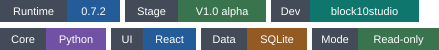

<h1 align="center">A股智研台｜AShare Insight Lab</h1>

<strong>简体中文</strong> · <a href="README.en.md">English</a>

本地优先的 A 股研究与只读行情工作台。

[版权与授权](COPYRIGHT.md) · [安全政策](SECURITY.md)

## 版本与阶段

源码版本常量 0.7.2（Data Source Status UI）；阶段文档为 V1.0-alpha-stage-freeze-docs，二者不是正式发行版本。已有日报、历史、信号、SQLite、行情源状态及快照驱动前端；不宣称实时服务或正式产品已验收。

## 能力与技术架构

Python、SQLite、AkShare、React/Vite；Tauri 桌面壳为研发路线。Marketaux 新闻为辅助数据；Longbridge 为候选只读源，历史 OAuth 阻塞仍待复核；Tushare 预留。

## 安全与授权

仅用于研究与模拟验证，不是投资建议，不读资产/持仓/订单，不下单、撤单或改单。数据来源及 API 许可独立审核，不提交凭据或个人交易数据。公开可见不等于开源许可。

## 文档导航

- [阶段冻结](docs/stage_freeze/V1.0-alpha-行情源控制台阶段冻结说明.md)
- [当前进展](docs/当前阶段进展.md)
- [版本记录](docs/版本记录.md)
- [数据源状态](docs/data/实时行情源状态与切换说明.md)
- [NOTICE](NOTICE.md)
- [固定源码](https://github.com/usydin/Ashare-insight-lab/tree/3f3de7383c51e4122adfe2dff4c13f11f2e0764d)

## 研发身份

**BlocK‘10STUdio** · 保留原有作者、项目归属及历史版权；研发身份不构成权属转移。本轮不改变许可或运行源码。
